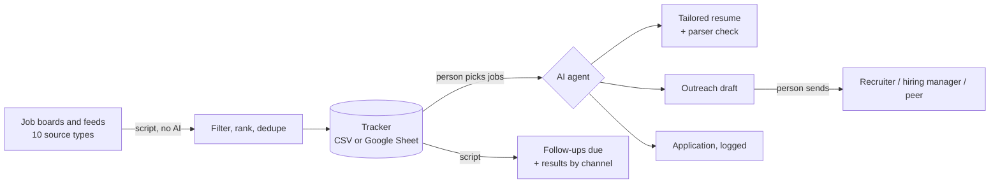

# agentic-job-hunt

A job search run by scripts, AI agents and one human. Scripts find and rank the jobs. Agents tailor resumes, draft outreach and prepare applications. You pick the jobs, send the messages and do the interviews.

It works for any role: set your job titles in one config file. You choose how much the AI does, from almost nothing to nearly everything.

## Get started

### Option 1: let an AI agent set it up (about 10 minutes)

This works whether or not you code. The agent installs what's missing, asks about your search, builds your tracker, interviews you about your experience, and runs the first scan.

- **You already use an agent** (Claude Code, Codex, Antigravity, Grok Build, Cline): open an empty folder with your resume in it and say *"Set up https://github.com/josephfanpm/agentic-job-hunt in this folder by following prompts/setup.md."*
- **You don't, or you've never used a terminal:** [START-HERE.md](START-HERE.md) shows which free app to install and the exact message to paste. No paid plan or code editor needed.

### Option 2: do it yourself

- **Not a programmer:** follow Steps 1 to 5 in [START-HERE.md](START-HERE.md). Every click is written out.
- **Developer:**

  ```bash
  git clone https://github.com/josephfanpm/agentic-job-hunt.git && cd agentic-job-hunt
  pip install -r requirements.txt
  python -m jobhunt init --resume path/to/your-resume.pdf    # asks a few questions
  python -m jobhunt scan                                     # today's ranked jobs
  ```

  Then continue with [GUIDE.md](GUIDE.md) from Step 2.

After setup, everyone uses [GUIDE.md](GUIDE.md) for the daily routine.

## What it does

| Stage | What happens | Needs AI? |
|---|---|---|
| **Set up** | One command drafts your profile from your resume, finds your target companies' job boards, and creates the tracker | No |
| **Scan** | Reads company job boards (Greenhouse, Lever, Ashby, Workable), remote boards (Remote OK, Remotive, We Work Remotely, Himalayas), Hacker News "Who is hiring?", Amazon, and optionally LinkedIn and Indeed. Filters, ranks and removes duplicates | No |
| **Pick** | Tick Pick on the jobs you want, in the sheet, on your phone, or from a morning email. Then tell your agent "work my picks" | No |
| **Find people** | Three LinkedIn searches per job (recruiters, hiring managers, peers), each a one-click link | No |
| **Check the resume** | Reads your PDF the way an applicant tracking system does, and shows which of the posting's terms your resume lacks | No |
| **Track** | Logs applications, lists follow-ups due, compares interview rates by channel | No |
| **Evaluate and research** | Grades a job's fit against your profile; writes a one-page company brief | Yes |
| **Tailor** | A one-page LaTeX resume and cover letter per job, from the real job description and your own facts | Yes |
| **Reach out** | A message matched to who's reading it. Agents draft; **you send** | Yes |
| **Apply** | Fills the application and logs it. Stops for referrals and sponsorship questions | Yes |
| **Interview** | A story bank, a mock interview with a tough-interviewer setting, and a debrief | Yes |
| **Offer** | Side-by-side comparison and a negotiation draft | Yes |

## Choose your flow

| Flow | The AI does | Pick it if |
|---|---|---|
| **Lean** | Only what you ask, for jobs you pick | You want the lowest AI usage |
| **Standard** | Reviews the scan, tailors and drafts for jobs you pick | You want a balance |
| **Full** | Evaluates every new job and prepares applications ahead | You want the least work |

```bash
python -m jobhunt mode lean      # or standard, full
```

In Lean mode with the CSV tracker, the daily scan uses no AI at all. [MODES.md](MODES.md) has the full comparison.

## Commands

| Command | Does |
|---|---|
| `python -m jobhunt init` | Set up your private folder, profile, config and tracker |
| `python -m jobhunt scan` | Find, filter and rank new jobs (`--dry-run` to preview) |
| `python -m jobhunt boards add "Company"` | Find and track a company's job board |
| `python -m jobhunt people "Company" "Job title"` | LinkedIn searches for recruiters, hiring managers and peers |
| `python -m jobhunt picks` | The jobs you ticked Pick and haven't applied to |
| `python -m jobhunt network find "Company"` | Who you already know there, from your LinkedIn data export |
| `python -m jobhunt check resume.pdf --jd job.txt` | Resume pre-flight and keyword gap |
| `python -m jobhunt applied "Company" --channel Referral` | Log an application |
| `python -m jobhunt due` | Follow-ups due today |
| `python -m jobhunt stats` | Interviews by channel |
| `python -m jobhunt mode` | Show or change the flow |
| `python -m jobhunt schedule on` | Run the scan automatically at log-on (`--at 08:00` for a set time) |
| `python -m jobhunt doctor` | Check the setup |

## Works with more than one agent

Claude, Codex, Antigravity, Grok, Muse, or an open model such as DeepSeek or Qwen in your IDE: any two can share one tracker. Each can create the Google Sheet, run the scan, tailor and apply. They follow one contract ([AGENTS.md](AGENTS.md)), so they never overwrite each other's work. Any agent that can run a command and edit a sheet can join. To start one on the whole search, paste the message in [prompts/kickoff.md](prompts/kickoff.md). Chat-only sites such as grok.com have their own version. GUIDE.md covers [setting up open-weight models](GUIDE.md#using-open-weight-models).

## The rules that make it work

- **You pick, agents execute.** The scan gives you a short ranked list. You choose; agents do the rest.
- **Referral before application.** Line up a referral first where you can. The tracker records the channel for every application, so you can see which one gets interviews.
- **Message a person for every application.**
- **Never invent anything.** Agents tailor only from a job description they fetched and facts in your own files. Pay, dates and locations are shown only when the posting states them.
- **Agents draft, you send.**
- **Your data stays yours.** Everything personal lives in `private/`, which is never committed.

## Guides

- **[START-HERE.md](START-HERE.md):** step-by-step setup for non-programmers
- **[GUIDE.md](GUIDE.md):** setup, the daily routine, the weekly review
- **[MODES.md](MODES.md):** the three flows and what each costs
- **[AGENTS.md](AGENTS.md):** the contract every agent follows
- **Prompts:**
  - Getting started: [setup](prompts/setup.md), [profile-interview](prompts/profile-interview.md) (your experience bank), [kickoff](prompts/kickoff.md) (for any agent, including Muse and Grok)
  - Finding: [daily-scan](prompts/daily-scan.md), [evaluate](prompts/evaluate.md), [research](prompts/research.md)
  - Daily: [work-picks](prompts/work-picks.md) (what "work my picks" does)
  - People: [network-scoring](prompts/network-scoring.md), [linkedin-search](prompts/linkedin-search.md), [outreach](prompts/outreach.md), [follow-up](prompts/follow-up.md), [check-email](prompts/check-email.md)
  - Applying: [tailor-resume](prompts/tailor-resume.md), [apply](prompts/apply.md), [create-sheet](prompts/create-sheet.md)
  - Interviews and offers: [interview-prep](prompts/interview-prep.md), [mock-interview](prompts/mock-interview.md), [offer](prompts/offer.md), [review](prompts/review.md)

## Development

```bash
pip install -r requirements.txt
python -m pytest -q
```

The scan engine uses only the Python standard library. `pymupdf` is needed for the resume check. Tests run without network access.

## Credits

- [career-ops](https://github.com/santifer/career-ops) by Santiago Fernández de Valderrama (MIT): the project that inspired this workflow.
- [Jake's Resume](https://github.com/jakegut/resume) (MIT): the LaTeX layout.
- Resume advice from [Diego Granados](https://www.linkedin.com/in/diegogranadosa/): no generic skills list; graduation year only.
- Networking method from Mikelle's [UNLISTED](https://mikellecareers.com) networking guide.
- Job data comes from each board's public feed. Listings from Remote OK and Remotive link back to those sites, as their terms ask.

## License

MIT

---

## Product write-up

*How I approached this as a product problem: who it's for, what I chose not to build, and why.*

### TL;DR

Job seekers spend most of their hours on low-value work: searching boards, reformatting resumes and filling in forms. Meanwhile, the highest-value work gets the least time: referrals, specific outreach, and interview practice. This project moves the low-value work to scripts and AI agents, so the person's time goes where it changes outcomes. The person stays in control of every decision that has their name on it.

**Status:** v0.2, in daily use for my own Senior PM search since November 2026. Open source, MIT licensed.

### The problem

| Who | What hurts today |
|---|---|
| **Active job seekers** | New roles are scattered across dozens of boards and company sites. Checking them by hand takes an hour a day, and the same role shows up three times. |
| | Every application wants a slightly different resume. Tailoring well takes 30–60 minutes per job, so people either skip it or send a generic one. |
| | An applicant tracking system can misread a resume (multi-column layouts, fused letters, text inside images), and the applicant never finds out why they got no reply. |
| | Referrals and messages to the right person get far better responses than cold applications, but finding that person and writing a specific message is slow, so it gets skipped. |
| | Nobody tracks which channel actually produces interviews, so effort never shifts toward what works. |
| **Non-technical job seekers** | AI job tools are either chat windows that forget everything or developer tools that assume a terminal and an IDE. |

**The two failure modes I wanted to avoid:**
1. **Mass-apply bots.** They send hundreds of applications on autopilot. Volume goes up, response rates go down, and accounts get flagged.
2. **Chat-only assistants.** They help with one resume at a time, but they don't find jobs, remember what you applied to, or tell you what's working.

### Goals and non-goals

**Goals**
- Cut the daily search to a short ranked list in seconds, at no AI cost.
- Make a tailored, parser-safe resume and a specific outreach message the default for every application.
- Keep a single record of jobs, applications and contacts that any agent or the person can use.
- Show which channels actually lead to interviews.
- Be usable by someone who has never opened a terminal.

**Non-goals**
- **Applying to as many jobs as possible.** Volume isn't the goal; interviews are.
- **Sending anything under the user's name without them.** Messages are drafts; the person sends.
- **Writing experience the person doesn't have.** Every claim must trace to the person's own files.
- **Locking users into one AI vendor.**

### Product principles

1. **The person picks; agents execute.** Judgment about *which* job stays human. Effort on *how* to apply moves to agents.
2. **Scripts before AI.** Anything a rule can do (search, filter, dedupe, rank, track) is a script: free, fast, repeatable and testable. AI is reserved for writing and judgment.
3. **No invented facts.** Pay, dates and locations appear only when the posting states them. Resume content comes only from the person's profile.
4. **One source of truth, many agents.** A shared tracker and a written contract let several agents work side by side without overwriting each other.
5. **Explain every decision.** Each ranked job carries a plain-language reason, and each scan reports what it filtered out and why.

### How it works



### Key decisions and trade-offs

| Decision | Alternative I rejected | Why | What it costs |
|---|---|---|---|
| **Rule-based scan, no AI** | Have an LLM read and score every posting | A scan reads hundreds of postings a day. Rules do it in about 3 seconds, cost nothing, and give the same answer every time | Ranking is cruder than a human read. Standard and Full modes add an AI review on top for people who want it |
| **Three modes: Lean, Standard, Full** | One fixed workflow | AI usage and cost vary a lot by person. Lean uses none on a quiet day; Full prepares applications ahead of time | More documentation and more paths to test |
| **The person sends every message** | Auto-send outreach | A message under someone's name is theirs to send. Auto-sent outreach is how bots get spotted and accounts get flagged | One manual step per message |
| **Referral first, then apply** | Apply immediately, ask for a referral later | Many referral systems only credit a referral made before the application | Some applications wait a day or two for a reply |
| **CSV tracker by default; Google Sheet optional** | Require Google Sheets | Local files need no account or connector, and a scheduled scan needs no agent | Spreadsheet features like dropdowns only come with the Sheet option |
| **Public job feeds only** | Scrape LinkedIn and Indeed directly | Public feeds are stable, allowed and fast. Scraping breaks often and risks blocks | LinkedIn and Indeed are an opt-in extra through a third-party library |
| **A written agent contract** (AGENTS.md) | Tie the workflow to one AI tool | Claude, Muse or any agent that can run a command can join | Rules live in prose, so each agent has to follow them |
| **No RAG or vector database** | Index the person's documents for retrieval | A profile is a few pages and fits in one prompt. Retrieval would add setup and maintenance for no accuracy gain | Worth revisiting once the profile grows past what fits in a prompt |

### What I learned from real data

I tested the scan against live feeds and real resumes, and changed the design based on what came back.

- **One employer crowded out the rest.** In an early scan, a single large company took 19 of the 25 slots. Now each scan caps any one company at 5, and the cap is a setting.
- **Benefits text skewed ranking.** "Health insurance" made every job look like a healthcare role. Benefits, pay-disclosure and legal lines are now left out before scoring.
- **Old postings at target companies matter.** A role open for months, at a company where the person has a referral, is still worth seeing. Those roles skip the age filter and show their open date.
- **Parser problems are invisible to the applicant.** The resume check caught fused letters in a real resume that would have made an applicant tracking system read "staffing" as "sta?ing". It now runs on 17 real resumes with no false alarms.
- **Hacker News posts are free text.** Company, title and location are best-effort there, so those jobs are labeled "check" rather than trusted.

### How I'd measure success

| Type | Metric | Why it matters |
|---|---|---|
| **North star** | Interviews per hour spent on the search | Captures both outcome and effort |
| **Inputs** | Share of applications with a referral or a message to a named person | The behavior that most improves response rates |
| | Share of tailored resumes that pass the parser check on the first try | Quality of what goes out |
| | Minutes from scan to first application each day | Friction in the daily loop |
| **Outcome by channel** | Interview rate for Referral vs Hiring manager message vs Cold application | Tells the person where to put next week's effort (`jobhunt stats`) |
| **Guardrails** | Claims on a resume that can't be traced to the profile: **0** | Trust |
| | Messages sent without the person's approval: **0** | Trust |
| | AI usage on a day with no applications (Lean mode): **0** | Cost |

The `stats` command won't rank channels until there are about 20 applications in each. With fewer than that, the differences are noise.

### Risks and mitigations

| Risk | Mitigation |
|---|---|
| The AI overstates experience | Profile-only rule; every number must have a source; the person reviews every resume before it goes out |
| A job board changes its feed | Each source is isolated, so one failure doesn't stop the scan; 73 automated tests run on every change |
| Two agents overwrite each other | Insert-only writes, claiming a job in Notes, and a scan that remembers what it has already shown |
| Personal data leaks | Everything personal lives in `private/`, which git never uploads; the scan sends only ordinary requests for public listings |
| Too complex for non-technical users | A click-by-click setup guide, a guided setup command, and a no-AI mode that works on its own |

### What's next

- **Opt-in auto-submit for standard application forms**, with a dry run by default. It fills the form and takes a screenshot, and submits only on an explicit go-ahead and only for jobs the person picked.
- **An MCP server**, so any AI tool can use the scan, tracker and checks directly.
- **Presets for other roles** (engineering, design, data, nursing), so setup is one choice instead of a config file.
- **A claim check** that traces every resume bullet back to a line in the person's profile.

**Deliberately not planned:** mass-applying, auto-sending messages, and scraping sites that don't offer public feeds.
